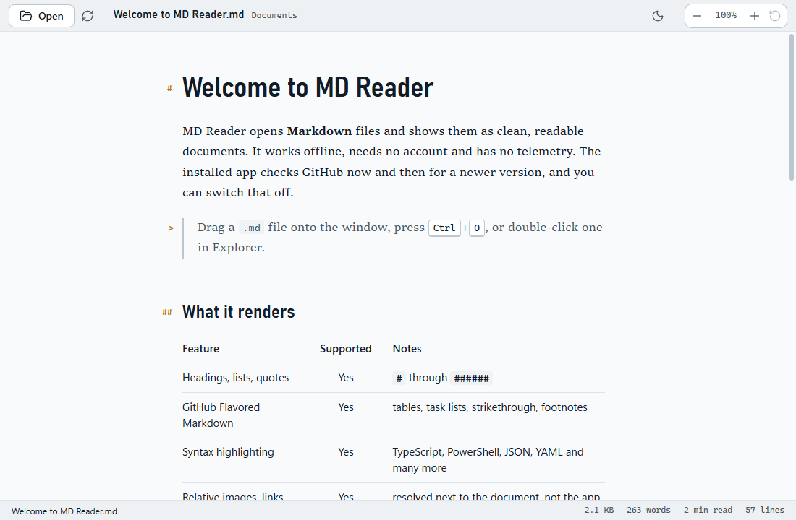
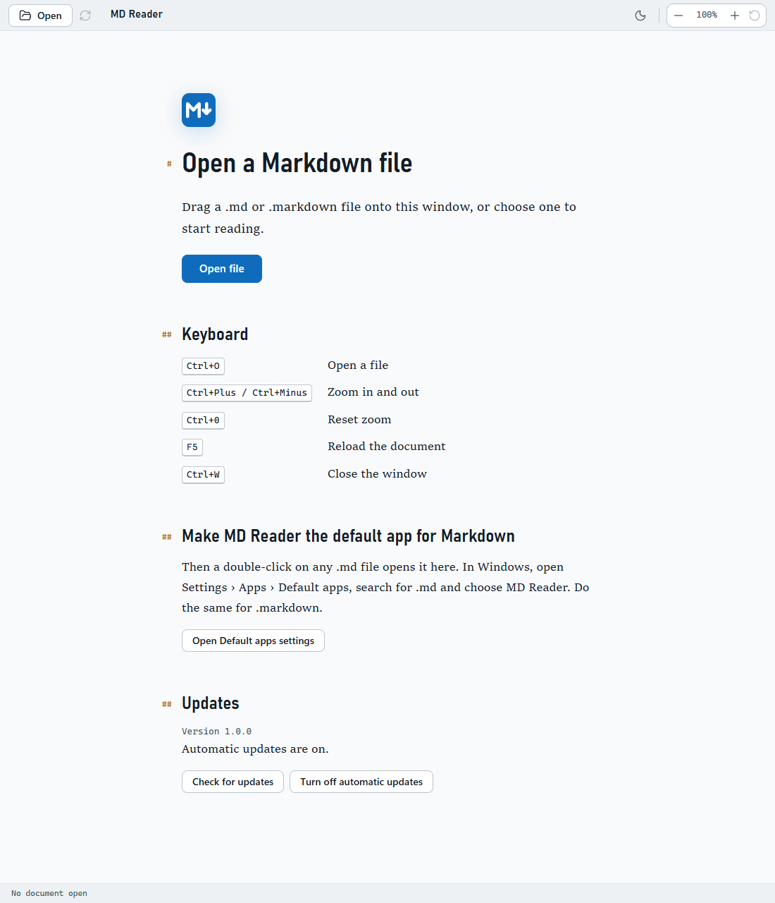
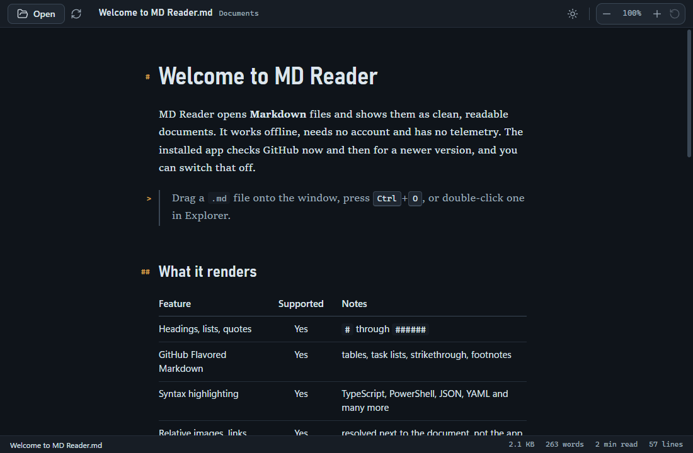
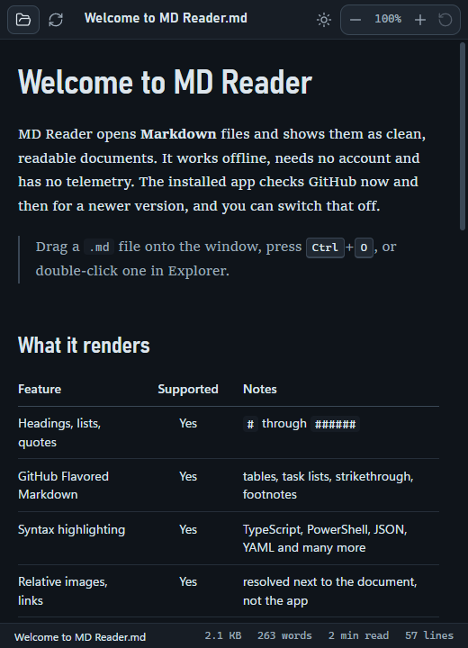
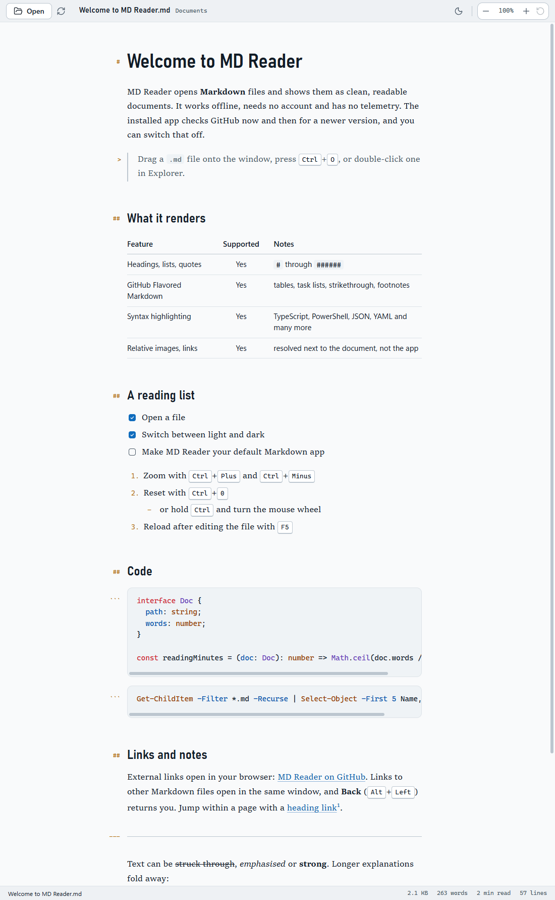

# MD Reader

A small, fast, offline Markdown reader for Windows 10 and 11. Double-click a `.md` file and read it as a clean document, in light or dark.

[](https://github.com/abhijithkm/md-reader/actions/workflows/ci.yml)



MD Reader is a reader, not an editor. It opens one document at a time, renders GitHub Flavored Markdown as a page made for reading, and gets out of the way. It has no account and no telemetry. The installed app looks on GitHub for a newer version and keeps itself up to date (you can [switch that off](#updates)). It treats every document as untrusted: scripts in a Markdown file cannot run, and a document cannot read your files. The only network requests a document can cause are for `https` images it links to.

- [Features](#features)
- [Screenshots](#screenshots)
- [Install](#install)
- [Updates](#updates)
- [Make MD Reader your default Markdown app](#make-md-reader-your-default-markdown-app)
- [Using MD Reader](#using-md-reader)
- [Build from source](#build-from-source)
- [Releases and CI](#releases-and-ci)
- [Known limitations](#known-limitations)
- [Security](#security)
- [Contributing](#contributing)
- [License](#license)

## Features

- **Complete Markdown.** Headings, emphasis, lists, task lists, GitHub Flavored Markdown tables, strikethrough, footnotes, block quotes, horizontal rules, links and images. Unicode text in any script.
- **A page made for reading.** A serif drawn for screens, headings in a narrower sans, and a line about 70 characters wide. The marks of the Markdown source (`#` to `######`, `>`, a code fence, `---`, and the `-` or number of each list item) hang quietly in the margin, so the level of a heading is clear at a glance. They are never selected, copied or read out, and a narrow window leaves them out. The start screen is set the same way. The fonts are the ones Windows ships (Sitka Text, Bahnschrift, Segoe UI Variable and Cascadia Mono), so nothing is downloaded.
- **Syntax highlighting** for fenced code blocks: the common web, systems and scripting languages, JSON, YAML, SQL, diff, plus PowerShell, batch, Dockerfile, HTTP and nginx.
- **Safe inline HTML.** `<details>`, `<kbd>`, ``, tables and similar elements render. Scripts, event handlers, frames, forms and styles are removed.
- **Relative images and links** resolve against the document's folder, not the app's. Links to other Markdown files open in the same window and Back returns you; `#heading` links scroll; web and mail links open in your default browser.
- **Opens files the Windows way:** the Open dialog (`Ctrl+O`), double-click in Explorer, Open with, drag and drop onto the window, or the command line. When MD Reader is already running, a new file opens in the existing window.
- **Light and dark** themes. It follows Windows until you pick one with the toolbar button, and remembers your choice.
- **Zoom** from 50% to 300% with the toolbar, the keyboard or `Ctrl` + mouse wheel. The level is remembered.
- **Status bar** with file name, size, word count, reading time and line count.
- **Long documents** (up to 5 MiB) render progressively, so the window stays responsive while a big file finishes.
- **Per-user installer** that needs no administrator rights, plus a portable executable.
- **Keeps itself up to date.** The installed app checks GitHub for a newer version, downloads it in the background, and installs it when you close the app. See [Updates](#updates).

## Screenshots

These are captured from the packaged application by [`e2e/screenshots.e2e.test.ts`](e2e/screenshots.e2e.test.ts) and show the window contents (without the Windows title bar). The document is [`docs/sample.md`](docs/sample.md).

|                                                                                Start screen                                                                                 |                                  Dark theme                                  |
| :-------------------------------------------------------------------------------------------------------------------------------------------------------------------------: | :--------------------------------------------------------------------------: |
|  |  |

|                                              A narrow window                                              |                                                                Everything the sample document contains                                                                 |
| :-------------------------------------------------------------------------------------------------------: | :--------------------------------------------------------------------------------------------------------------------------------------------------------------------: |
|  |  |

## Install

Download the latest release from the [Releases page](https://github.com/abhijithkm/md-reader/releases/latest). You need Windows 10 or 11 (64-bit).

### Installer (recommended)

1. Download `MDReader-Setup-<version>.exe` and run it. There is no wizard: it installs and starts MD Reader.
2. It installs for your Windows account only, under `%LOCALAPPDATA%\Programs`, so no administrator rights are needed. It adds Start menu and Desktop shortcuts and registers MD Reader for `.md` and `.markdown` files.
3. From version 1.1.0 on, it updates itself (see [Updates](#updates)). You can also update by hand: run a newer installer, which replaces the old version and keeps your settings. A copy older than 1.1.0 cannot update itself and needs that once.
4. To uninstall, use Settings > Apps > Installed apps (Apps & features on Windows 10) > MD Reader > Uninstall. This also removes the folder the updater keeps its files in (see [Updates](#updates)). Your settings stay in `%APPDATA%\MD Reader` until you delete that folder.

### Portable

`MDReader-Portable-<version>.exe` runs without installing. It starts more slowly than the installed app, because it unpacks itself each time, and it does not register file types. To open a Markdown file with it from Explorer, use Open with > Choose another app and browse to the executable. It cannot replace itself, so it only tells you when a newer version exists; download that from the Releases page.

### Windows SmartScreen

The releases are **not code-signed**, because no signing certificate is configured. The first time you run a download, Windows SmartScreen may show "Windows protected your PC". Choose **More info**, then **Run anyway**. If you would like to check what you downloaded first, compare its hash with `SHA256SUMS.txt` from the same release:

```powershell
Get-FileHash -Algorithm SHA256 .\MDReader-Setup-1.0.0.exe
```

## Updates

The installed app (from `MDReader-Setup`) keeps itself up to date from version 1.1.0 on:

1. About 15 seconds after it starts, and then every six hours while it is open, it asks GitHub whether a newer version has been released. If that fails, for example because you are offline, it tries again about 15 minutes later.
2. If there is one, it checks what the release offers and downloads the installer in the background. When it is ready, a small notice says so.
3. The new version installs when you close the app. **Restart now** in the notice does it at once. No administrator rights are needed, and your settings are kept.

The start screen, which MD Reader shows when it starts without a document, has an **Updates** section that shows the version you have, what updating is doing, and buttons to check now or to turn automatic updates off. The first time you run a version with updates, a notice explains the check and offers **Turn off**. The first check can run about 15 seconds after that first start, so use **Turn off** before then, or in the Updates section later, if you do not want it. The choice is saved in `settings.json` in `%APPDATA%\MD Reader` (`automaticUpdates`). With updates turned off, nothing is installed when you close the app either.

**What leaves your computer.** HTTPS requests to GitHub: for the list of releases, for the update file (`latest.yml`), and for the installer. GitHub answers a request for a release file by pointing at one of its own file servers, so the download is requested from there. GitHub sees your IP address, as it does for any download, and, when MD Reader downloads an update, which version you are updating from, because it asks for that version's block map so that it can download only what changed. MD Reader sends no account, no identifier of your installation and nothing about you or your documents. The update library keeps a random id in `%APPDATA%\MD Reader\.updaterId` and would send it with every request; MD Reader replaces it with a fixed word, and an end-to-end test checks that the id is never sent. The requests come from the main process; the window itself makes no network connections. With updates switched off there are no update requests at all, and a check or a download that was under way when you switched them off is stopped.

**What protects an update.**

- Where it comes from is fixed when the app is built: this repository's GitHub Releases. Nothing in the environment, the settings or a document can change it.
- Before anything is downloaded, the app checks what the release offers: one installer file with a plain name and a SHA-512, a plain version number that goes with the release's tag (`v` followed by the version), and nothing that asks for administrator rights or a web installer. Anything else is refused.
- The download is checked against that SHA-512, and an older version is never installed over a newer one.
- Release notes are never shown in the app; the notice only names the version.
- A request that gets no answer for a minute is given up on, and so is a chain of more than ten redirects, so a bad connection or a misbehaving server cannot leave the app waiting for ever.

**What does not.** The builds are **not code-signed**, so the app cannot check who built an update: it trusts what this repository's latest release contains. Anyone who can publish a release there, or who takes over the account that does, can run a program on every computer that has automatic updates on. That is the price of updating without a code-signing certificate, and the reason to keep the publishing account safe and to restrict who can create release tags (see [docs/RELEASING.md](docs/RELEASING.md#keeping-updates-safe)). Signing the builds later adds a check that such an attacker cannot forge.

The updater keeps files in `%LOCALAPPDATA%\md-reader-updater`: a copy of the installer, so that the next update downloads only what changed (about 100 MB), and the last update it downloaded (another 100 MB or so) until the next update replaces it. Uninstalling removes that folder.

**If an update does not arrive,** the updater's own log says why: `update.log` in `%APPDATA%\MD Reader`. It records when MD Reader checked, which version it found, what it downloaded and the reason for any failure, keeps itself under about 200 KB, and never leaves your computer. It can contain file paths with your Windows user name, so look through it before you share it.

The portable executable only reports that a newer version exists, with a button to open its download page. Pre-releases are versioned `1.2.0-beta.1` (or `-alpha.1`): a copy of a final release is never offered one, a beta copy is offered newer betas and the final release, and an alpha copy newer alphas and betas and the final release.

## Make MD Reader your default Markdown app

The installer registers MD Reader for `.md` and `.markdown` and lists it under Default apps. If you have never chosen a program for those types, a double-click may already open MD Reader. If they open in another program, Windows keeps the choice you made earlier and no installer can change it, so pick MD Reader once:

- **Windows 11:** Settings > Apps > Default apps. Type `.md` in the search box, choose MD Reader, and select **Set default**. Do the same for `.markdown`.
- **Windows 10:** Settings > Apps > Default apps > **Choose default apps by file type**, then pick MD Reader for `.md` and `.markdown`.
- **From Explorer, for one type:** right-click a `.md` file > Open with > Choose another app > MD Reader > **Always**.

The start screen of MD Reader has an **Open Default apps settings** button that takes you to the first page.

### Troubleshooting file associations

| Problem                                                  | What to do                                                                                                                                                   |
| :------------------------------------------------------- | :----------------------------------------------------------------------------------------------------------------------------------------------------------- |
| MD Reader is not in the list of apps                     | You may be using the portable executable, which registers nothing. Run the installer. If you already did, sign out of Windows and in again, then look again. |
| A double-click still opens another program               | Windows keeps the program you chose for each type, and an installer cannot override that. Change it with the steps above.                                    |
| `.md` files show the wrong icon                          | Explorer caches icons. Restart Explorer (Task Manager > Windows Explorer > Restart) or sign out and in.                                                      |
| The default is MD Reader but nothing opens               | Run the installer again to repair the registration, then set the default again.                                                                              |
| After uninstalling, Windows asks how to open `.md` files | That is expected: the choice pointed at a program that no longer exists. Pick another program.                                                               |

## Using MD Reader

**Command line.** Pass the file as the first argument. Relative paths are resolved against the current folder, and paths with spaces or non-English characters work when quoted. `MDReader.exe` is in the install folder (right-click the Start menu shortcut and choose Open file location to see it):

```powershell
MDReader.exe "C:\Documents\README.md"
```

If MD Reader is already running, the file opens in that window instead of starting a second one.

**Keyboard and mouse**

| Action                                           | Shortcut                                            |
| :----------------------------------------------- | :-------------------------------------------------- |
| Open a file                                      | `Ctrl+O`                                            |
| Zoom in / out                                    | `Ctrl+Plus` / `Ctrl+Minus`, or `Ctrl` + mouse wheel |
| Reset zoom                                       | `Ctrl+0`                                            |
| Reload the file after editing it                 | `F5` or `Ctrl+R`                                    |
| Back, after following a link to another document | `Alt+Left`                                          |
| Close the window                                 | `Ctrl+W`                                            |

**Settings.** MD Reader's own settings are your theme and zoom level, whether automatic updates are on, and whether you have read the note about them, in `%APPDATA%\MD Reader\settings.json`. Electron keeps its usual cache files in the same folder, and the updater keeps its `update.log` and the library's `.updaterId` file there (see [Updates](#updates)). MD Reader does not remember which documents you opened.

## Build from source

### Prerequisites

- Windows 10 or 11, 64-bit.
- [Node.js](https://nodejs.org/) 24 (see [`.node-version`](.node-version); 22.22.2 and later 22.x, and 26 and later, also work) and the npm that comes with it.
- Git. About 2 GB of free disk space, and internet access the first time (Electron and the installer tools are downloaded once).

No Visual Studio, Python or other native build tools are needed: the app has no native dependencies.

### Run it in development

```bash
git clone https://github.com/abhijithkm/md-reader.git
cd md-reader
npm ci
npm run dev
```

The first `npm run dev` downloads the Electron binary. Press `F12` to open the developer tools in a development build; packaged builds have them switched off.

### Check, build and package

| Command                                                     | What it does                                                                                                                                                                                                                                                                                     |
| :---------------------------------------------------------- | :----------------------------------------------------------------------------------------------------------------------------------------------------------------------------------------------------------------------------------------------------------------------------------------------- |
| `npm run dev`                                               | Starts the app with hot reload.                                                                                                                                                                                                                                                                  |
| `npm run check`                                             | Lint, type-check, unit tests and build, in one go.                                                                                                                                                                                                                                               |
| `npm run lint`, `npm run typecheck`, `npm run format:check` | The individual checks. `npm run format` fixes formatting.                                                                                                                                                                                                                                        |
| `npm test`                                                  | Unit and integration tests (Vitest).                                                                                                                                                                                                                                                             |
| `npm run build`                                             | Compiles the app into `out/`.                                                                                                                                                                                                                                                                    |
| `npm start`                                                 | Previews the compiled app.                                                                                                                                                                                                                                                                       |
| `npm run test:e2e`                                          | End-to-end tests that drive the real app. Run `npm run build` first. See [docs/TESTING.md](docs/TESTING.md).                                                                                                                                                                                     |
| `npm run pack`                                              | Builds the unpacked app in `release\win-unpacked`.                                                                                                                                                                                                                                               |
| `npm run dist`                                              | Builds the installer and the portable executable in `release\`.                                                                                                                                                                                                                                  |
| `npm run checksums`                                         | Writes `release\SHA256SUMS.txt` for the installer, the portable executable, `latest.yml` and the block map.                                                                                                                                                                                      |
| `npm run verify:release`                                    | Checks what `npm run dist` produced: file names and sizes, archive contents, Electron hardening, version information, signing status, that `latest.yml` names the installer with its size and SHA-512, that the block map is there, and that the update configuration points at this repository. |
| `npm run icons`                                             | Regenerates the application icons in `build/` from the SVG sources.                                                                                                                                                                                                                              |

To build the installer:

```bash
npm ci
npm run dist
npm run verify:release
```

You get `release\MDReader-Setup-<version>.exe` and `release\MDReader-Portable-<version>.exe`. Both are unsigned unless you configure signing yourself (see [docs/RELEASING.md](docs/RELEASING.md#code-signing)).

### Tech stack

Electron, React and TypeScript (strict), built with Vite through electron-vite. Markdown is rendered by `react-markdown` with `remark-gfm`, sanitized by `rehype-sanitize` and highlighted by `rehype-highlight`. Tests use Vitest, Testing Library and Playwright (over the Chrome DevTools Protocol, against the real Electron app). Packaging uses electron-builder (NSIS installer and portable). See [docs/ARCHITECTURE.md](docs/ARCHITECTURE.md) for how the pieces fit together.

## Releases and CI

- **CI** ([`ci.yml`](.github/workflows/ci.yml)) runs on every push to `main` and every pull request, on Windows: lint, format check, type-check, unit tests, build, the update flow against a feed served from the runner itself, package, verify the package, and the end-to-end tests against the packaged app.
- **Release** ([`release.yml`](.github/workflows/release.yml)) runs when a tag such as `v1.0.0` is pushed. It repeats those checks, builds the installer and the portable executable, really installs the new installer over an older one (also the way the updater does) and uninstalls it, runs the end-to-end tests against the installed app, writes `SHA256SUMS.txt`, and only then publishes a GitHub Release with the installer, the portable executable, the checksums and the two files installed copies read to update themselves (`latest.yml` and the installer's `.blockmap`).

The step-by-step process for cutting a release is in [docs/RELEASING.md](docs/RELEASING.md).

## Known limitations

- One window and one document at a time: no tabs, no editing, no find-in-page, no Mermaid diagrams or math.
- Files over 5 MiB are refused. A document with tens of thousands of blocks (for example a huge table or list) can take several seconds to finish rendering; the window stays usable meanwhile.
- A changed file is not reloaded automatically. Press `F5`.
- Images: `https` images load from the network when a document references them (so they are missing offline), plain `http` images are blocked, and local images must be PNG, JPEG, GIF, WebP, AVIF, BMP, ICO or SVG, up to 25 MB.
- Links to local files other than Markdown documents are not opened.
- Two protections against files made to hang the window can change how a document looks. Quotes or lists stacked more than 100 levels on one line, or a line indented more than 400 columns, make the whole document appear as plain text with a notice. A code block with a line of more than 1,000 characters (or more than 200,000 characters in all) is shown without syntax colours. Real documents come nowhere near these limits.
- Text is read as UTF-8 (with or without a byte-order mark) or UTF-16 with a byte-order mark; anything else is treated as Windows-1252.
- Windows 10 and 11 on x64 only. There is no ARM64 build and no per-machine (all users) install.
- The builds are not code-signed, so SmartScreen warns on first run (see above), and the updater cannot check who built an update (see [Updates](#updates)).
- The portable executable does not register file types, starts slower than the installed app, and cannot update itself. Copies older than 1.1.0 cannot update themselves either.
- Updating needs access to GitHub. It is silent when you are offline and tries again about 15 minutes later. A download that fails again and again is tried less often: after 15 minutes, then after an hour, then with the checks every six hours. If you ask for a check again within 30 seconds of one that found nothing newer, or within 5 seconds of one that failed, you are given that result instead of a new request.
- The first update check can happen about 15 seconds after the first start, before the explanation has been read. It can be turned off from that explanation or from the Updates section.
- The Updates section is on the start screen, which MD Reader shows when it is started without a document, for example from the Start menu or the Desktop shortcut. It is not shown while a document is open. Someone who always opens documents from Explorer sees the one-time explanation (with **Turn off**) and the notice that an update is ready, but has to start MD Reader without a document to check by hand or to change the setting later.
- The updater keeps up to about 200 MB in `%LOCALAPPDATA%\md-reader-updater` while MD Reader is installed. Uninstalling removes it.
- An update is installed by a silent installer that starts when you close the app and takes a few seconds. If Windows is shut down in that time, the installation can be left half done; run the installer from the release page to put it right. If Windows will not start that installer as you, the update library tries again with its own elevation helper, and Windows asks for your permission for an installer from an unknown publisher. Decline, and update by hand.

## Security

Markdown is untrusted input, so the app is built so that a hostile document can do very little:

- The window runs with context isolation, the sandbox on, and Node.js integration off. The page is served from a private `app://` origin and talks to the main process through a small, validated set of messages; there is no file system, shell or process access from the page.
- A strict Content Security Policy blocks inline scripts, `eval`, plugins, frames and network connections. Only images may come from outside the app: `https:` and `data:` images, and local image files that the main process serves after checking them.
- Raw HTML in a document is sanitized with a GitHub-style allow-list before it reaches the page.
- Links are checked before they are followed: only `http`, `https` and `mailto` links leave the app, and only Markdown files open inside it. The window never navigates away from the app, opens no pop-ups, and downloads nothing.
- Local files named by a document are checked in the main process: network shares, Windows device names and NTFS alternate data streams are refused, and only image files are served. A symbolic link or junction is followed step by step, so one that leads to a network share is refused before anything is sent to the server.
- The window never presents your Windows client certificate to a server, and the page cannot ask the main process to open a file of its own choosing: the path of a dropped file comes from the drop itself, and Back only returns to documents already shown.
- A hostile file cannot hang or blank the window: absurd nesting is shown as plain text, very long code lines are not highlighted, and a part of a document that cannot be drawn is replaced by a message while the rest is shown.
- Updating is done by the main process and takes no input from the page: the source is fixed in the package, what a release offers is checked before it is downloaded, each download is checked against the hash in the release's `latest.yml`, versions are accepted only as plain version numbers, an older version never replaces a newer one, requests that stall or redirect for ever are cut off, and the page can only ask to check, to switch updating on or off (the setting in the Updates section), and to restart into an update that was already downloaded and checked. Because the builds are not code-signed, the app cannot verify who built an update: whoever can publish a release on this repository can update every installed copy (see [Updates](#updates)).
- Electron's runtime hardening is switched on in the packaged app: it cannot be run as plain Node.js, ignores `NODE_OPTIONS` and `--inspect`, and only loads its code from the application archive, whose integrity is checked at startup.

[docs/ARCHITECTURE.md](docs/ARCHITECTURE.md#security-model) describes each measure and where it lives. To report a vulnerability, please use the repository's Security tab (Report a vulnerability) rather than a public issue, so there is time to fix it first.

## Contributing

Bug reports and pull requests are welcome.

1. Fork the repository and create a branch.
2. `npm ci`, make your change, and add or update tests. Behaviour changes need a test that fails without the change.
3. Run `npm run check`. Run `npm run test:e2e` as well when you touch the main process, the preload script, packaging or file handling.
4. Open a pull request that says what changed and why. CI must pass.

Code style is enforced by ESLint and Prettier (`npm run lint`, `npm run format`). The project is strict TypeScript with no `any`; keep new code in the existing module layout described in [docs/ARCHITECTURE.md](docs/ARCHITECTURE.md).

## License

[MIT](LICENSE) © 2026 Abhijith KM. Electron and Chromium ship with their own licenses in the application folder (`LICENSE.electron.txt` and `LICENSES.chromium.html`).
